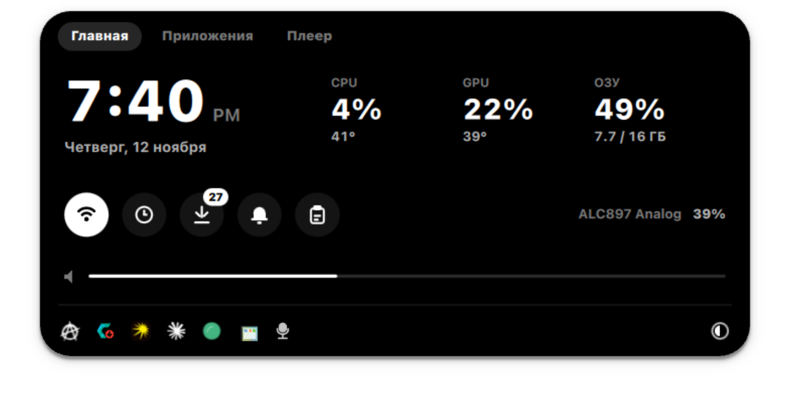
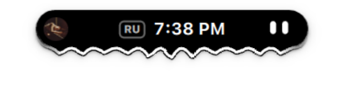
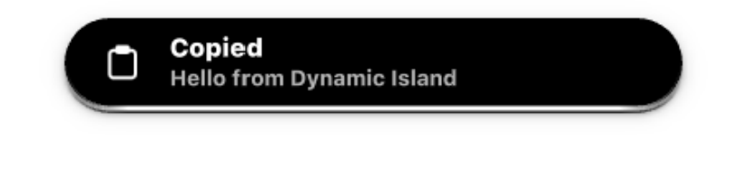
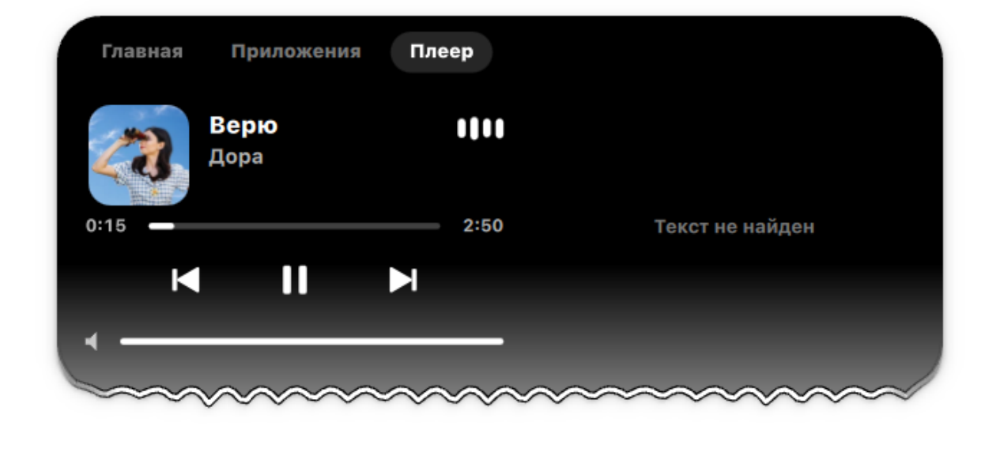
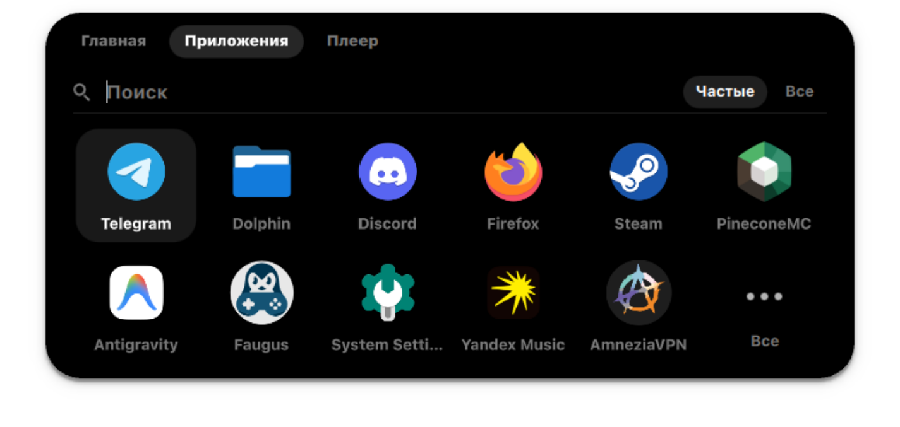

# Dynamic Island для KDE Plasma

Живой «остров» вверху экрана для **KDE Plasma 6 на Wayland**, написанный на [Quickshell](https://quickshell.org).
Он может полностью заменить верхнюю панель: часы, плеер, трей, громкость, раскладка, Wi‑Fi, уведомления и лаунчер приложений — всё в одной чёрной капле с жидкими анимациями и глазками, которые следят за курсором.

<p align="center">
  
</p>

## Как выглядит

| В покое | Играет музыка |
|:---:|:---:|
|  |  |
| Глазки смотрят на курсор, моргают, засыпают без дела | Обложка, время, глазки кивают в такт, край волнится под музыку |

| Приветствие | Уведомление |
|:---:|:---:|
|  |  |

**Плеер** — обложка, прогресс, управление, громкость конкретного плеера и синхронный текст песни (название трека и исполнитель отправляются на lrclib.net, только когда плеер раскрыт; обложка грузится по ссылке, которую даёт сам плеер):

<p align="center"></p>

**Приложения** — открываются по клавише Meta, частые сверху, поиск, все приложения по группам:

<p align="center"></p>

## Что умеет

- **Свёрнутый остров** — время, раскладка RU/EN, глазки-персонаж с эмоциями (подмигивает при копировании, пугается резкого движения мыши, радуется, когда курсор рядом, засыпает через 2 минуты тишины).
- **Музыка** — любой MPRIS-плеер (Spotify, браузер, Яндекс Музыка…), волны края от `cava`, раскрытый плеер с текстом песни.
- **Главная** — крупные часы и дата, загрузка CPU / GPU / ОЗУ с температурами, ползунок громкости и выбор устройства вывода, трей с меню, выбор цвета текста и фона.
- **Кнопки** — Wi‑Fi (список сетей, подключение с паролем), таймер (5 / 10 / 30 мин или своё время, по окончании остров «звенит»), обновления системы (pacman + yay), история уведомлений, буфер обмена (последние скопированные строки, клик — скопировать снова).
- **Уведомления** — остров сам становится сервером уведомлений: показывает их с иконкой приложения, клик открывает приложение.
- **«Скриншот готов»** — после Win+Shift+S показывает превью снимка.
- **Точки приватности** — оранжевая, когда приложение пишет с микрофона, зелёная — при показе экрана или камере.
- **Всплывашки** — громкость и смена раскладки.
- **Не мешает в играх и кино** — прячется под полноэкранными и развёрнутыми окнами, выезжает при наведении к верхнему краю.

Ресурсы: ~160–200 МБ памяти, в покое < 1 % одного ядра, с музыкой ~5–6 % одного ядра.

## Требования

- KDE Plasma 6, сессия **Wayland** (нужен KWin — через его скрипт остров узнаёт позицию курсора и окна)
- `quickshell`, `cava`, `python-gobject`, `sqlite`, `networkmanager`, `qt6-tools` (`qdbus6`), `kconfig`
- по желанию: `pacman-contrib` и `yay` — для плитки обновлений, `konsole` — чтобы их ставить
- шрифт берётся из настроек Plasma; задумано под **SF Pro Text**, но подойдёт любой

Проверено на CachyOS / Arch. На других дистрибутивах поставьте те же пакеты своим менеджером.

## Установка

```bash
git clone https://github.com/am4ex/dynamic-island.git
cd dynamic-island
./install.sh --autostart --meta
```

Скрипт проверит зависимости (на Arch предложит доставить через pacman), сделает ссылку `~/.config/quickshell/island` на папку проекта и запустит остров. Флаги можно не указывать:

| Флаг | Что делает |
|---|---|
| `--autostart` | запускать остров при входе в систему |
| `--meta` | клавиша Meta открывает вкладку «Приложения» вместо меню Plasma |
| `--run` | просто перезапустить остров |
| `--uninstall` | убрать ссылку, автозапуск и привязку Meta |

Запуск вручную:

```bash
quickshell -p ~/.config/quickshell/island
```

### Уведомления

Чтобы уведомления показывал остров, а не Plasma: правый клик по трею → «Настроить системный лоток» → «Элементы» → «Уведомления» → «Отключено», затем перезапустите plasmashell (`systemctl --user restart plasma-plasmashell`). Вернуть — так же, выбрав «Показывать».

### Несколько мониторов

Остров появляется на первом мониторе. Другой можно указать именем из `kscreen-doctor -o`:

```bash
ISLAND_SCREEN=HDMI-A-1 quickshell -p ~/.config/quickshell/island
```

### Язык

Интерфейс берёт язык системы: русский, если система на русском, иначе английский. Задать вручную:

```bash
ISLAND_LANG=ru quickshell -p ~/.config/quickshell/island
```

## Управление

| Действие | Как |
|---|---|
| Раскрыть остров | навести курсор |
| Закрепить раскрытым | клик по свёрнутому острову |
| Приложения | Meta (с `--meta`) или вкладка «Приложения»; Tab — частые / все, Esc — закрыть |
| Сменить устройство вывода звука | клик по его названию на «Главной» |
| Громкость | ползунок или колесо мыши над ним |
| Цвет темы | кнопка ◐ справа в трее |

## Устройство

| Файл | Зачем |
|---|---|
| `shell.qml` | окно-слой поверх всего, маска ввода |
| `Island.qml` | состояния острова, анимации, уведомления, плееры |
| `LiquidBody.qml` | жидкое тело с волнами |
| `Eyes.qml` | глазки и их эмоции |
| `HomeDashboard.qml`, `HomeView.qml` | «Главная», трей, панели Wi‑Fi / истории / буфера |
| `MediaView.qml`, `Lyrics.qml`, `AudioBars.qml` | плеер, текст песни, данные cava |
| `AppsView.qml` | лаунчер приложений |
| `cursor_bridge.py`, `kwin_cursor.js` | мост к KWin: курсор, окна, раскладка, Meta |
| `Theme.qml` | цвета и шрифт, сохраняются между запусками |
